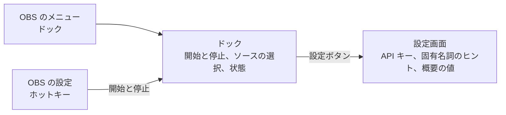

# 利用者が触れる部分の仕様

## はじめに

この文書は、プラグインの利用者が操作し、目にする部分の仕様です。元のツール realtime-summary-generator は、簡易的な試作として動いていました。出力先のソース名は決め打ちで、入力のマイクと動作の値は `.env` と起動時の引数で指定します。プラグインでは、これらをすべて OBS の画面の中で設定できるようにします。

2026-11-10 に依頼者のレビューを受けて確定しました。段階 2 のキーの入力画面と、段階 4 のドックの実装の前提です。

## 元のツールの決め打ちの置き換え

| 元のツールの方式 | 出所 | プラグインでの置き換え |
| --- | --- | --- |
| 出力先のソース名を `字幕（日本語）`、`字幕（英語）`、`概要（日本語）` に固定 | `obs_output.py:6-8` | ドックで既存のテキストソースから選ぶ。使わない出力は選ばない |
| 出力先は Text (GDI+) だけ | `obs_output.py` | Text (GDI+) と Text (FreeType 2) から選べる |
| マイクを `sounddevice` の数値 ID で指定。既定は Windows の既定の入力 | `.env` の `AUDIO_INPUT_DEVICE` | ドックで OBS の音声ソースから選ぶ。マイク以外の音声ソースも選べる |
| OpenAI と Gemini の API キー | `.env` | OpenAI の API キーだけを設定画面で入力する。DPAPI で暗号化して保存する |
| OBS WebSocket のパスワードと接続先 | `.env` と固定値 | 不要になる |
| 固有名詞のヒントを JSON の文字列配列で指定 | `.env` の `OPENAI_TRANSCRIPTION_KEYWORDS` | 設定画面の複数行の入力欄に 1 行 1 語句で書く |
| 概要の 1 行の最大文字数と更新の最短間隔 | 起動時の引数 `--summary-max-chars`、`--summary-interval-seconds` | 設定画面の数値の入力欄 |
| ログの水準 | `.env` の `LOG_LEVEL` | 設定項目を設けない。OBS のログに本文なしの情報だけを書く |
| 開始はコマンドの実行、終了は `Ctrl+C` | コンソール | ドックの開始と停止のボタン、およびホットキー |

## 画面の構成

利用者が触れる場所は、ドックと設定画面とホットキーの 3 つです。配信中に触る操作はドックに置きます。初回に一度だけ決める項目は、ドックから開く設定画面に置きます。



### ドック

OBS のメニューの「ドック」に「リアルタイム字幕・翻訳・要約」を追加します。英語の表示名は Realtime Translate & Summary です。

```
┌ リアルタイム字幕・翻訳・要約 ───────────────┐
│ 状態: ● 動作中  12:34                         │
│                                               │
│ 音声        [ vocal@totalmix            ▼ ]   │
│ 日本語字幕  [ 字幕（日本語）            ▼ ]   │
│ 英語字幕    [ 字幕（英語）              ▼ ]   │
│ 概要        [ (使わない)                ▼ ]   │
│                                               │
│ [      停止      ]              [ 設定… ]     │
│                                               │
│ 今回の利用: 送信した音声 3:12、テキスト生成   │
│             入力 4,210 / 出力 1,880 トークン  │
└───────────────────────────────────────────────┘
```

項目の内容は次のとおりです。

| 項目 | 内容 |
| --- | --- |
| 状態 | 停止中、接続中、動作中、再接続中 (n/5 回目)、エラーのいずれかを表示する。動作中は経過時間を添える。エラーの場合は原因と対処を 1 文で表示する |
| 音声 | 音声を出す OBS のソースを一覧から選ぶ。選んだソースがミュート中のときは、送信していないことを状態の欄に表示する |
| 日本語字幕、英語字幕、概要 | Text (GDI+) と Text (FreeType 2) のソースを一覧から選ぶ。先頭の項目は「(使わない)」。同じソースを 2 つの出力に選んだ場合は開始できない |
| 開始と停止 | 1 つのボタンで切り替える。開始すると表示先を空にしてから字幕を出す。停止すると OpenAI への送信が止まり、選んだテキストソースを停止中の表示に戻す |
| 停止中の表示 | 表示先に、出力ごとの仮の文字列 (日本語字幕、英語字幕、概要。OBS の表示言語に合わせる) を出す。開始の前にテキストソースの位置と見た目を調整できるようにするためである。設定画面のチェックで、空にする動作へ切り替えられる。既定は仮の文字列を出す |
| 設定 | 設定画面を開く |
| 今回の利用 | 開始から停止までに OpenAI へ送信した音声の秒数と、テキスト生成のトークン数。金額は表示しない。単価は OpenAI が変更するため、README で料金のページへの参照を案内する。文字起こしの課金の対象となる秒数の規則は公式の文書で確認できないため、送信した秒数を表示する |

動作中は、音声と表示先の選択を変更できないようにします。変更は停止してから行います。

開始の前に、次の項目を確認します。満たさない場合は開始せず、状態の欄に理由を表示します。

- API キーが保存されている
- 音声のソースが選ばれ、存在する
- 表示先が 1 つ以上選ばれ、どれもテキストソースとして存在する

### 設定画面

```
┌ 設定 ─────────────────────────────────────────┐
│ OpenAI API キー                               │
│   状態: 保存済み                               │
│   [ ●●●●●●●●●●●●●●●●            ] [保存] [削除]│
│   API キーの発行: platform.openai.com          │
│                                               │
│ 固有名詞のヒント (1 行に 1 語句)               │
│   ┌───────────────────────────┐               │
│   │ AllegroMoltoV             │               │
│   │ 倉庫くん                  │               │
│   └───────────────────────────┘               │
│                                               │
│ 概要の 1 行の最大文字数   [ 30 ]  (4 以上)     │
│ 概要の更新の最短間隔      [ 10 ] 秒            │
│                                               │
│                         [ OK ] [ キャンセル ]  │
└───────────────────────────────────────────────┘
```

API キーの欄には、このプラグインは無料で、OpenAI API の利用料金は利用者の OpenAI アカウントに別途請求されることを注記します。

API キーの欄は、INIT.md 6.3 節の決定にしたがいます。入力欄は伏せ字にし、保存済みのキーを表示しません。表示するのは保存済みと未設定の状態だけです。変更は新しいキーの入力と保存で行い、削除のボタンで保存済みのキーを消します。

固有名詞のヒントは、元のツールと同じ検証をします。空白だけの行、`<` と `>` を含む行は保存せず、該当する行を画面に示します。

設定画面での変更は、次の開始から反映します。

### ホットキー

OBS の設定の「ホットキー」に、開始と停止の 2 つのホットキーを登録します。配信中にドックを開かずに操作できるようにするためです。割り当ての既定値はありません。

## 設定の保存先

| 設定 | 保存先 |
| --- | --- |
| API キー | `%APPDATA%\obs-studio\plugin_config\realtime-translate-summary\` に DPAPI で暗号化して保存 |
| 固有名詞のヒント、概要の 2 つの値 | 同じフォルダーの設定ファイル |
| 音声と表示先の選択 | シーンコレクション。`obs_frontend_add_save_callback` で保存と読み込みをする |
| ホットキーの割り当て | シーンコレクション。プラグインが登録したホットキーの割り当ては OBS が自動では保存しないため、選択と同じ保存のコールバックで obs_hotkey_save と obs_hotkey_load により保存と復元をする |

## エラーの表示

元のツールで終了していた場面では、OBS を終了させず、処理を止めてドックの状態の欄に原因を表示します。表示の例は次のとおりです。

| 場面 | 状態の欄の表示 |
| --- | --- |
| API キーが未設定 | API キーが未設定です。設定から入力してください |
| 認証に失敗 | API キーが拒否されました。キーを確認してください |
| 再接続を 5 回失敗 | OpenAI に接続できません。ネットワークを確認して再開してください |
| 表示先のソースが削除された | 表示先のソースが見つかりません。選び直してください |
| 英訳または概要が失敗 | 処理は止めない。状態の欄に警告を出し、最後の正常な表示を残す |

## 設計の判断

### 音声と表示先の選択をシーンコレクションに保存する理由

音声と表示先として選ぶソースは、シーンコレクションごとに存在します。プラグインの設定ファイルに保存すると、シーンコレクションを切り替えたときに、存在しないソースを指すことになります。シーンコレクションに保存すれば、切り替え先で保存した選択が復元されます。保存するのはソースの名前だけで、秘密情報と本文を含まないため、シーンコレクションを書き出しても漏えいしません。この判断により、INIT.md 4.3 節の、API キー以外の設定をシーンコレクションに保存しない、という記述を変更しました。

### 表示中の本文をシーンコレクションに残さない

表示先のテキストソースの text はソースの設定に入るため、OBS がシーンコレクションを保存すると本文も書き出されます。OBS は終了の通知より前にシーンコレクションを保存します。そのため、メインウィンドウの close の要求を受けた時点と、シーンコレクションの切り替えが始まる時点で停止し、表示を空にします。異常終了で残った本文は、起動時に選択を読み込んだ時点で空にします。動作中は、OBS の自動保存のたびにその時点の本文がシーンコレクションに入ります。

### 配信の開始と停止とは連動させない

最初の版では、ドックとホットキーだけで開始と停止をします。配信を終えたあとに停止し忘れると、文字起こしの課金が続きます。配信の停止に合わせて自動で停止する機能の要否は、段階 5.5 のユーザーテストで判断します。
